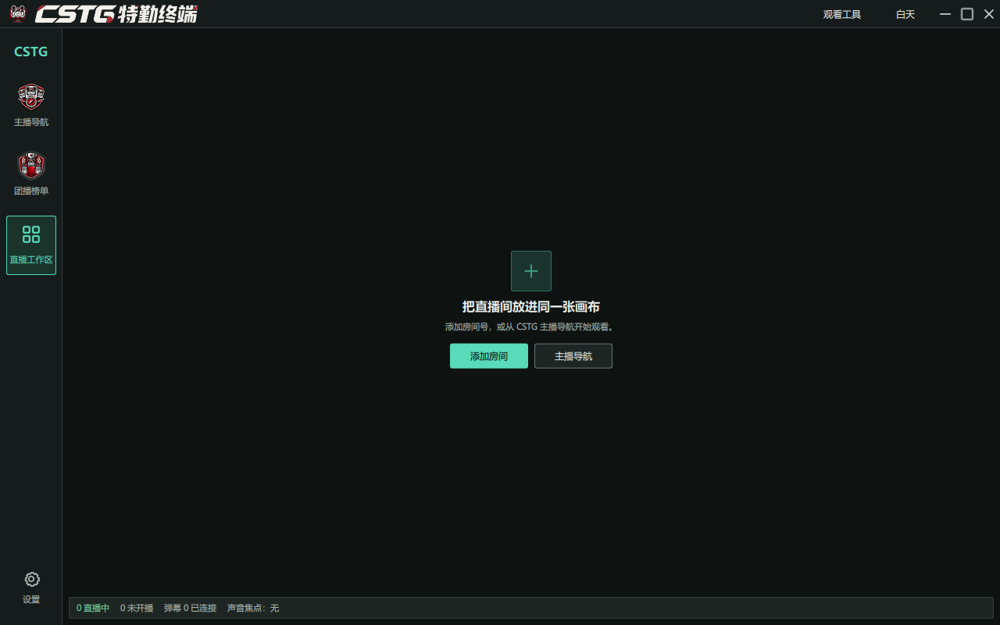
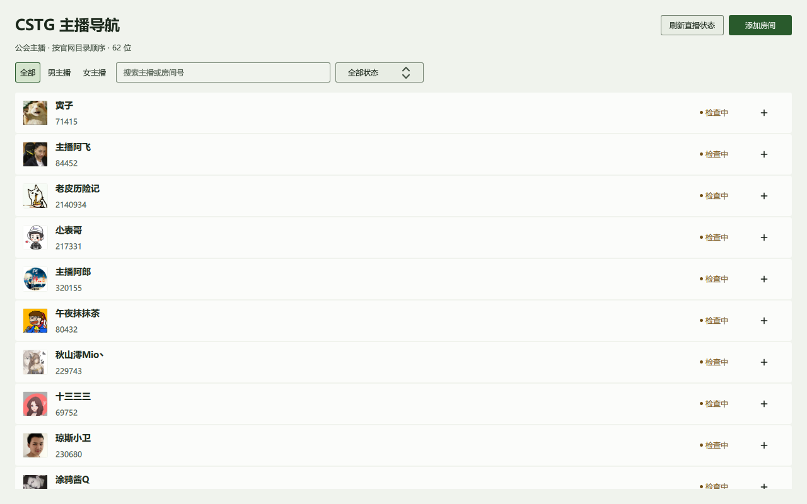
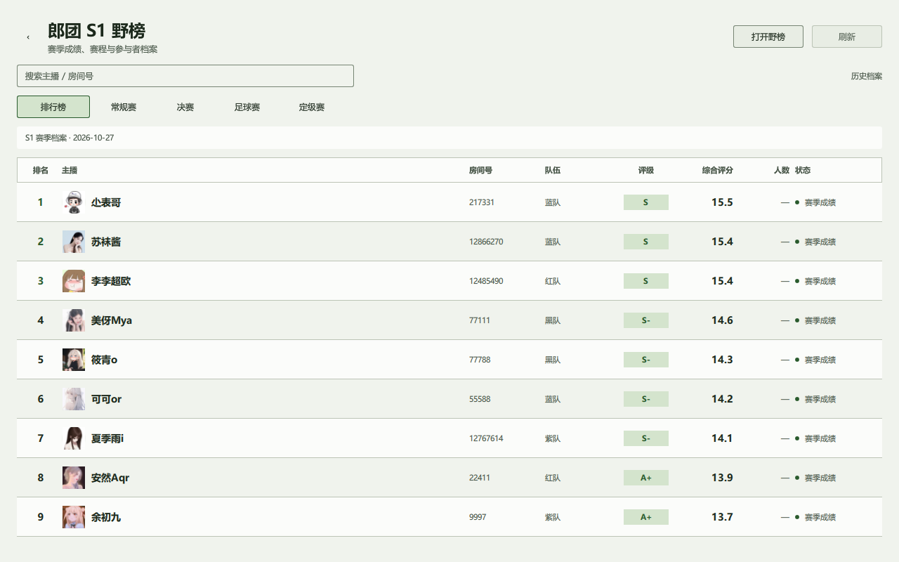
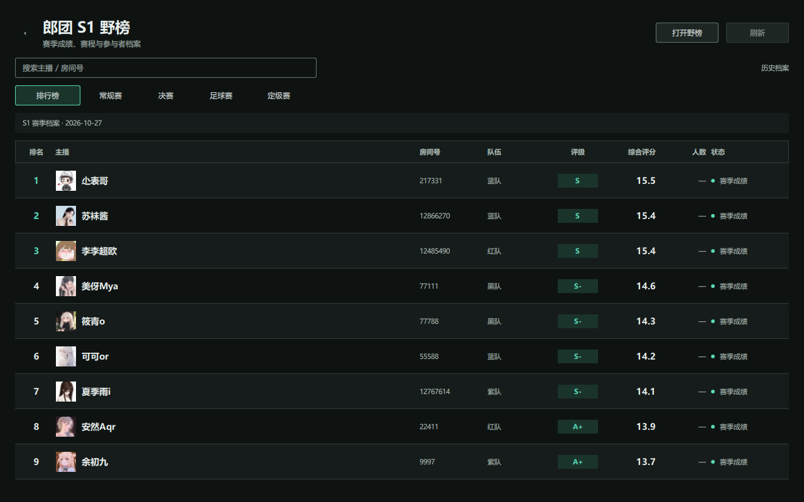
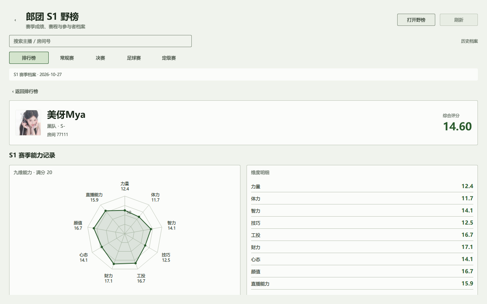

# CSTG 特勤终端

DouyuMonitor（CSTG 特勤终端）是面向斗鱼直播的 Windows x64 原生桌面客户端，基于 Qt Quick/QML、C++20 和 libmpv。它提供多房间观看、CSTG 主播导航、郎团 S1 榜单与历史档案。`main` 仅维护原生 Qt 实现；旧 Electron/TypeScript 实现保存在 `legacy-framework` 分支供历史追溯。

## 界面预览

首张为用户提供的夜间模式完整应用窗口，展示导航、工具入口及未添加房间的观看工作区。其余为当前生产 QML 页面在 Qt 中实际渲染的截图：主播导航使用内置的 62 位公开目录和公开头像，截图未查询开播状态；榜单与详情展示 `2026-10-27` 的 S1 历史档案。这些预览不代表实时直播或当前在线状态。详见[截图来源与验证](docs/images/V1.0.0-PREVIEWS.md)。











## 当前版本

- 当前稳定版：`V1.0.0`
- Windows x64 安装包：[`DouyuMonitor-Setup-V1.0.0.exe`](https://github.com/KevinTsoi2002/DouyuMonitor/releases/tag/V1.0.0)
- 历史 24 路测试版：[`V0.2.20-beta.24`](https://github.com/KevinTsoi2002/DouyuMonitor/releases/tag/V0.2.20-beta.24)，不属于当前稳定版
- 未提供代码签名；下载后请以 Release 页面中的 SHA-256 值校验安装包

## 功能

- 按房间号或主播名搜索并添加斗鱼直播间
- 自动、主直播间和双主直播间布局；稳定版最多 16 路解码
- 每个房间独立播放控制、清晰度、音量、弹幕及状态信息
- 可收起的房间列表、导航栏和观看工具面板，为直播画面保留空间
- CSTG 主播导航提供全部、男主播和女主播筛选、搜索及直播状态
- 郎团 S1 榜单、赛事分类、历史档案、主播详情与能力雷达图
- 日间与夜间主题，设置会保存并在下次启动时恢复
- 历史记录、收藏、自定义分组、工作区预设、状态监控和播放恢复
- 主播开播状态写入本地缓存，短时间重复打开导航页不会再次排队检查全部主播
- 声音总控、单声道/多声道、独立音量和默认音频焦点
- StreamGet 动态清晰度列表、播放源重试和状态 Toast
- 应用级全屏，支持 F11 切换和 Escape 退出
- Windows 系统通知、快捷键和关闭生命周期保护
- Windows 托盘后台托管：隐藏窗口后继续保留音频、状态检测和通知，暂停视频与弹幕渲染；从托盘恢复时自动重新渲染

## 技术边界

- UI：Qt Quick/QML
- 应用逻辑：C++20
- 播放：libmpv + OpenGL（发布目录加载名为 `mpv.dll`）
- 斗鱼解析：独立 `streamget_service.exe` 子进程
- 弹幕：Qt WebSockets 原生客户端
- 安装器：Inno Setup 6 Windows 安装器
- 不使用 Electron、Chromium、Node.js、Qt WebEngine 或网页播放器

## 快速开始

### 环境要求

- Windows x64
- Visual Studio 2022，含 MSVC x64 工具链
- CMake 3.24 或更高版本、Ninja
- Qt 6 MSVC 2022 x64（V1.0.0 使用 `6.12.0` 构建并验证）
- 已准备好的 libmpv SDK，包含头文件、`libmpv.lib` 和 `libmpv-2.dll`

### 配置和构建

在项目根目录的 Visual Studio x64 Developer PowerShell 中设置依赖路径：

```powershell
$env:QT_ROOT = 'D:\Qt\6.12.0\msvc2022_64'
$env:MPV_ROOT = (Resolve-Path .\native\sdk\mpv).Path
Set-Location .\native
```

后续命令均在同一终端的 `native` 目录内执行：

```powershell
cmake --preset windows-x64-release
cmake --build --preset windows-x64-release
ctest --preset windows-x64-release
```

启动 Release 程序：

```powershell
.\out\build\windows-x64-release\douyu_monitor_native.exe
```

关闭按钮支持询问、后台托管或完全退出，按设置执行；最小化进入托盘后台托管。后台继续保留音频、StreamGet 与状态通知。托盘“退出程序”可完全退出，双击或选择“显示窗口”可恢复画面和弹幕。

### 构建 Windows 安装包

先构建 Release，再执行：

```powershell
.\scripts\build-windows-installer.ps1
```

输出目录必须尚不存在；重复构建请同时传入一对新的 `-StageRoot` 与 `-InstallerOutputDir`，已有产物会被保留。

安装包输出到 `native/out/installer/DouyuMonitor-Setup-V1.0.0.exe`。安装器文件名会从 CMake 项目版本自动生成。24 路全解码测试版仅保留在历史 Release 中，不作为 V1.0.0 稳定包发布。运行安装包时可选择安装目录；如果选择 `D:\` 这样的磁盘根目录，安装器会自动使用 `D:\DouyuMonitor`，不会把程序文件直接写入根目录。安装完成后会创建开始菜单和可选的桌面快捷方式，并可直接启动程序。卸载入口由 Inno Setup 生成的 `unins000.exe` 提供，同时登记到 Windows 设置的“已安装的应用”。

CSTG狼团S1导航页展示应用内置的公会名单、主播头像和开播状态，不根据直播资料动态扩张名单。已确认房间号可以直接加入当前工作区；无法自动确认的成员需要在行内手工输入房间号。快捷加入受当前构建的布局容量限制。隐藏导航页的空工作区启动时不会为名单检查启动服务。

### CSTG狼团S1导航与郎团S1野榜

主播导航按公会主播目录列出名单，可按全部、男主播和女主播筛选，并支持搜索、直播状态查看和加入工作区。郎团 S1 榜单提供总览、赛事页面和历史档案；主播详情显示能力维度与雷达图，历史档案缺失的数据保持为空，不以虚构分值补齐。

榜单按列对齐排名、主播、房间号、队伍、评级与综合评分；人数等来源缺失字段保留为空，归档页面明确标注历史赛季成绩。

## StreamGet 服务

服务源码位于 `native/service`。首次准备环境：

```powershell
.\scripts\bootstrap-streamget-service.ps1
.\scripts\build-streamget-service.ps1
```

服务通过私有 JSONL stdin/stdout 协议与 Qt 主程序通信。播放地址只在当前房间会话内存中使用，不写入日志、配置或诊断文件；Cookie、Token、签名和原始弹幕帧同样不会持久化。

## 目录和文件职责

完整的逐文件职责说明见：[文件职责索引](docs/文件职责索引.md)。主要边界如下：

| 目录 | 职责 |
| --- | --- |
| `native/app` | Qt 应用入口、QML 组件、面板、对话框和图标资源 |
| `native/src/ui` | QML 暴露的控制器、模型和 libmpv Quick Item |
| `native/src/workspace` | 房间会话、工作区持久化、布局、质量、通知和状态调度 |
| `native/src/media` | 播放源模型和 StreamGet 播放控制 |
| `native/src/service` | Qt 与 StreamGet 子进程之间的协议和进程管理 |
| `native/src/danmaku` | 斗鱼弹幕协议、Socket、治理和会话管理 |
| `native/service` | 独立的 StreamGet Python 服务及单元测试 |
| `native/tests` | C++、QML 和服务回归测试 |
| `native/cmake` | 运行时依赖校验、Qt 部署和服务复制脚本 |
| `native/scripts` | 依赖准备、服务构建和 Windows 安装包脚本 |
| `docs` | 当前 Qt 设计、计划、文件职责索引和中文开发日志；保留的 2026-08-24 迁移日志维持原始审计记录 |

## 验证

发布前至少执行 Release 全量 CTest、安装包 stage 的 `--self-test` 和载荷扫描。真实斗鱼 1/4/9/12/16/24 路长时间播放、弹幕稳定性及用户机器上的 CPU/GPU/内存验收仍需在目标环境完成。
